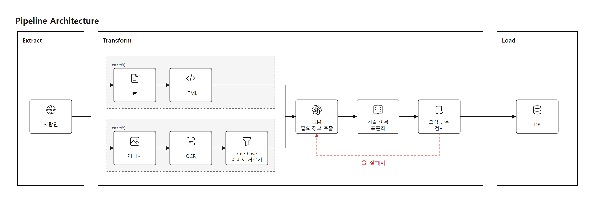

# job-skill — 채용공고 역량 추출

사람인의 IT 채용공고 가운데 **0~3년차가 지원할 수 있는 공고**를 모은다. 공고마다 필요한 역량(필수·우대·업무·기타)을 정해진 틀로 뽑아 DB에 넣는다.
뽑은 역량은 사용자 역량과 매칭하는 데 쓴다.



## 흐름

1. **수집 (Extract)**
   - 사람인 직무 목록(직무 코드)에서 공고를 받는다.
   - 목록의 경력 조건으로 최소 요구 연수 3년 이하만 남긴다. 교육생 공고는 뺀다.
2. **글로 바꾸기 (Transform)**
   - 글 공고: 본문 HTML에서 화면에 보이는 글만 쓴다(`html_text.py`).
   - 이미지 공고:
     - PaddleOCR로 글자와 좌표를 뽑는다.
     - 필요 없는 단락(회사 소개, 복리후생 등)을 낱말 규칙(rule base)으로 뺀다.
     - 표는 칸 순서대로 정리한다(`table_layout.py`).
3. **LLM 필요 정보 추출:** gpt-5.6-luna(reasoning low)가 처리한다. → [그림](docs/llm_extract.png)
   - 모집 단위(자리)를 나눈다: 직무별, 신입/경력별
   - 단위마다 필수 · 우대 · 업무 · 기타로 나눈다.
   - 줄마다 요건을 적는다: 능력 + 기술 + 관계(예시 / 택1 / 모두 / 능력만) + 근거
4. **기술 이름 표준화:** `capabilities.json` 사전으로 처리한다.
   - 별칭은 표준 이름으로 바꾼다.
   - 일반 낱말은 뺀다.
   - 사전에 없는 이름은 확인 필요로 표시한다.
5. **모집 단위 검사 (코드):** 의심되면 힌트를 붙여 LLM을 한 번 더 부른다. → [그림](docs/unit_check.png)
   1. 신입·경력을 빠짐없이 담았는가
   2. 모집 직무를 빠짐없이 담았는가
   3. IT 직무인데 내용이 비어 있지 않은가
6. **DB 저장 (Load):** PostgreSQL에 넣는다(`db_load.py`). → [ERD](docs/erd.png), [물리 설계](docs/physical-design.md) ([그림](docs/erd-physical.png))

## 파일

| 파일 | 내용 |
|---|---|
| `sample_random.py` | 수집: 사람인 직무 목록에서 0~3년 공고를 무작위로 뽑는다 → `<출력>/targets.tsv`, `pages/` |
| `sample_postings.py` | 수집(예전): 본문이 이미지뿐인 공고를 직무별로 고른다 |
| `fetch_images.py` | 공고 본문의 이미지를 받는다. 사람인 템플릿 이미지는 빼고, 받은 파일이 진짜 이미지인지 확인한다. |
| `common.py` | 공용 경로. 데이터 폴더는 환경변수 `OCR_DATA_DIR`로 고른다(예: `sample3`). |
| `html_text.py` | 글 공고: 보이는 글만, 표는 '■ 머리말' + 칸 글로 잇는다. |
| `run_paddle.py`, `dump_paddle_boxes.py` | PaddleOCR: 이미지 → 줄 상자 좌표와 글자 |
| `section_split.py` | 단락 나누기 + 필요 없는 단락 빼기(rule base). 파이프라인에서는 `--paddle-only`로 돌린다. |
| `table_layout.py` | OCR 상자를 표 구조대로 잇는다(왼쪽 머리말 표, 위쪽 머리말 열 표). |
| `extract_skills.py` | LLM 추출, 표준화, 모집 단위 검사. 브라우저 채점 화면 `out/extract/index.html`도 만든다. |
| `capabilities.json`, `capdict.py` | 표준화 사전(능력 61개, 기술 184개, 제외할 말)과 조회 코드. 사용자 역량도 같은 사전을 쓴다. |
| `db/schema.sql` | DB 표 만들기(PostgreSQL DDL). 설명은 [docs/physical-design.md](docs/physical-design.md) |
| `db_load.py` | DB 저장: 표 만들기(`init`), 사전 동기화(`sync-dict`), 공고·추출 결과 넣기(`load`). 여러 번 돌려도 겹치지 않는다. |
| `docker-compose.yml`, `.env.example` | 로컬 개발용 PostgreSQL(Docker). 비밀번호는 `.env`(올리지 않음) |
| `collect.py` | Airflow 수집: 두 직무 목록을 경력 필터를 켜고 끝까지 보기, 새 공고 고르기(목록 − 아는 번호, 마감일, 버린 공고) |
| `recheck.py` | ① 안의 수정·마감 확인: 다시 볼 공고 고르기('수정'·사라진 공고), 본문 지문 비교, 전체 페이지의 '접수마감' 확인 |
| `db_queries.py` | 파이프라인이 다음 할 일을 정하려고 DB에서 읽고 쓰는 함수(진행 공고, 밀린 공고, 하루 비용 등) |
| `notify.py` | Slack 알림(실패, 비용 상한, 결과, 하루 비용, 넘어간 공고). 숫자·상태와 넘어간 공고의 번호·링크만 보낸다(제목·내용 X). |
| `pipeline_tasks.py` | Airflow 태스크 함수. 실행마다 `data/runs/<dag>/<run>/` 폴더를 만들고 위 스크립트를 돌린다. |
| `airflow/`, `docker-compose.airflow.yml` | Airflow 3.3.2 Docker 묶음과 DAG 3개(`airflow/dags/job_skill_dags.py`). 아래 [Airflow로 돌리기](#airflow로-돌리기) |
| `db/migrations/` | 이미 표가 있는 DB에 적용할 변경(새로 만들 때는 `db/schema.sql`에 이미 들어 있음) |
| `tests/` | 시험(pytest). 사람인·LLM·Slack은 가짜, DB 시험은 `career-db`에 임시 DB를 만들었다 지운다. |
| `docs/` | 그림(파이프라인, 추출 방법, LLM 단계, 단위 검사, ERD), [물리 설계](docs/physical-design.md), [기술 스택 결정](docs/pipeline-stack.md), [OCR 비교 실험](docs/ocr-comparison.md) |
| `run_tesseract.py` 등 | OCR 비교 실험 코드 → [docs/ocr-comparison.md](docs/ocr-comparison.md) |

## 실행

준비
- Python 3.12에 `pillow`, `numpy`, `openai`, `psycopg[binary]`를 설치한다.
- PaddleOCR은 별도 가상환경에 설치한다(`requirements-paddle.txt`, GPU는 [OCR 비교 실험](docs/ocr-comparison.md#측정-환경) 참고).
- 환경변수 `OPENAI_API_KEY`를 설정한다(LLM).
- DB는 Docker로 띄운다: `.env.example`을 `.env`로 복사해 비밀번호를 정하고 `docker compose up -d`.
  PostgreSQL 17이 `localhost:5433`에 뜬다(컨테이너 `career-db`, DB·계정 `career`, 내 컴퓨터에서만 접속). `db_load.py`는 `.env`의 `DATABASE_URL`을 읽는다.
  사람마다 자기 컴퓨터에 따로 뜨는 DB라 데이터는 공유되지 않는다. 샘플은 아래 `db_load.py`로 넣는다.
  이 파이프라인의 표는 모두 `job` 스키마에 있다(BE 표는 기본 `public`). 다른 쪽에서 읽을 때는 `job.posting`처럼 부른다.

```powershell
py -3.12 sample_random.py --out sample3 --per-role 10      # 1. 수집
$env:OCR_DATA_DIR = "sample3"
py -3.12 fetch_images.py                                  # 2. 이미지 받기
<venv-paddle>\Scripts\python.exe dump_paddle_boxes.py --gpu   # 3. OCR
py -3.12 section_split.py --paddle-only                   # 4. 단락 나누기·빼기
py -3.12 extract_skills.py --models gpt-5.6-luna --examples --tag=-ex   # 5. LLM 추출·표준화·단위 검사 (유료)
py -3.12 db_load.py init                                  # 6. DB: 표 만들기 (처음 한 번)
py -3.12 db_load.py sync-dict                             #    사전 넣기 (사전을 고칠 때마다)
py -3.12 db_load.py load --run gpt-5.6-luna-ex            #    공고·추출 결과 넣기
```

비용은 공고당 약 $0.004다(luna low, 다시 부르기 포함).
`--examples`는 프롬프트에 예시 답안을 붙인다(지금 쓰는 설정). `--tag`는 결과 폴더 이름 뒤에 붙는다(`out/extract/gpt-5.6-luna-ex/`).
`-ex`가 `-`로 시작해서 `--tag -ex`라고 띄어 쓰면 옵션으로 읽힌다. 꼭 `--tag=-ex`로 쓴다. `--max-usd 1.0`을 주면 그 금액에서 추출을 멈춘다.
추출 결과에는 표준화 전 답, 확인 필요 사유(`[{검사, 내용}]`), 프롬프트·사전 버전, 입력 해시, 비용이 함께 저장된다.

## Airflow로 돌리기

노트북의 Docker에서 DAG 3개가 수집 → OCR → LLM 추출 → DB 저장을 자동으로 하고, Slack으로 알린다.
설계는 [docs/superpowers/specs/2026-10-27-airflow-dags-design.md](docs/superpowers/specs/2026-10-27-airflow-dags-design.md), 태스크 그림은 [③](docs/dag-backfill.png) · [①](docs/dag-daily.png), 수정·마감을 잡는 방법은 [그림](docs/recheck-cases.png).

| DAG | 언제 | 하는 일 |
|---|---|---|
| ③ 일회성 전체 수집 `backfill_once` | 관리 화면에서 **직접 한 번** | 진행 중인 대상 공고 전부를 DB 저장까지. LLM 상한은 실행 한 번에 $10 |
| ① 매일 수집 `daily_collect` | 매일 00:00 | 목록 전체를 보고 새 공고 + 밀린 공고 수집, '수정'된 공고는 본문이 바뀐 것만 다시 추출, 목록에서 사라진 공고는 '접수마감'이면 마감, 마감일 반영. 시작할 때 어제 LLM 비용을 Slack으로 |

목록은 사람인 경력 필터(신입·경력 3년 이하·경력무관)를 켜고 받는다. 예전 ② 수정 확인은 ①에 합쳤다 — 사람인이 '수정' 표시를 약 24시간만 보여 줘서 매일 봐야 한다.

①의 LLM 비용은 하루(KST) $5까지만 쓴다. 상한에 닿으면 추출을 멈추고 Slack으로 알린다. 못 한 공고는 다음 ①이 먼저 처리한다.

**처음 한 번 준비**
1. `.env`에 Airflow 값을 채운다(`.env.example` 참고). 무작위 값은 이렇게 만든다.
   ```powershell
   py -3.12 -c "import base64,os; print(base64.urlsafe_b64encode(os.urandom(32)).decode())"   # AIRFLOW_FERNET_KEY
   py -3.12 -c "import secrets; print(secrets.token_urlsafe(32))"                             # AIRFLOW_JWT_SECRET, 비밀번호들
   ```
   `SLACK_WEBHOOK_URL`에는 Slack 채널 웹훅 주소를 넣는다. `OPENAI_API_KEY`는 Windows 환경변수에 두면 그대로 넘어간다.
2. Docker Desktop에서 GPU를 쓸 수 있어야 한다(NVIDIA 드라이버 + WSL2).
3. Paddle GPU 휠(1.9GB)을 미리 받는다. 이미지를 만들 때만 쓰고, 저장소에는 올리지 않는다(`airflow/wheels/`). 끊기면 같은 명령으로 이어받는다.
   ```powershell
   curl.exe -C - --create-dirs -o airflow/wheels/paddlepaddle_gpu-3.2.2-cp312-cp312-linux_x86_64.whl https://paddle-whl.cdn.bcebos.com/stable/cu126/paddlepaddle-gpu/paddlepaddle_gpu-3.2.2-cp312-cp312-linux_x86_64.whl
   ```
4. 서빙 DB(`docker compose up -d`)가 이미 표가 있는 DB라면 변경을 적용한다(여러 번 해도 안전).
   ```powershell
   docker cp db/migrations/001_airflow.sql career-db:/tmp/001_airflow.sql
   docker exec career-db psql -U career -d career -v ON_ERROR_STOP=1 -f /tmp/001_airflow.sql
   ```
5. Airflow를 띄운다. 이미지는 처음에 15~20분 걸리고 약 19GB다.
   ```powershell
   docker compose -f docker-compose.airflow.yml build
   docker compose -f docker-compose.airflow.yml up -d
   ```
   관리 화면은 http://localhost:8080 (내 컴퓨터에서만)이다. 계정 `admin` / 비밀번호 `admin`(내 컴퓨터에서만 열려서 간단히 둠, 바꾸려면 `.env`의 `AIRFLOW_ADMIN_PASSWORD`).

**돌리는 순서**
1. ①은 꺼진 채로, ③은 켜진 채로 올라온다(③은 일정이 없어 저절로 돌지 않는다).
2. 관리 화면에서 **③ 일회성 전체 수집**을 실행한다(▶). 시험 삼아 몇 개만 하려면 실행할 때 `max_new`에 숫자를 넣는다.
3. ③이 끝나면 **①을 켠다.** 켜는 순간 놓친 가장 최근 회차가 한 번 바로 돈다. 그다음부터는 매일 00:00에 돈다.

- ③이 끝나기 전에 ①을 켜서 겹쳐 돌아도 자리 1개짜리 풀 3개(`saramin`·`gpu`·`llm`, airflow-init이 만듦)가 사람인 요청·GPU OCR·LLM 추출을 한 번에 하나씩만 돌린다.
- 실행마다 받은 본문·이미지·OCR·추출 결과는 `data/runs/<dag_id>/<run_id>/`에 남는다(저장소에 올리지 않음). 하루 상한은 이 폴더의 ① 결과 파일로 센다.
- 어떤 태스크든 두 번 다시 시도해도 실패하면 Slack으로 알린다. 고친 뒤 관리 화면에서 그 태스크부터 다시 실행하면 된다.
- DB 저장은 공고마다 따로 커밋한다. 연결 끊김·교착 같은 일시 오류는 그 공고를 3번까지 다시 하고, 다시 해도 같은 오류인 공고는 건너뛰고 나머지를 저장한다. 실패가 남으면 "DB 저장 실패 N건"으로 태스크가 실패해 Airflow가 다시 하고, 그래도 안 되면 Slack으로 알린다(실패 알림에 공고번호·원인·사람인 링크가 실린다).
- 끄기: `docker compose -f docker-compose.airflow.yml down` (실행 기록은 볼륨 `career-airflow-pgdata`에 남는다).

**시험**
```powershell
py -3.12 -m pip install -r requirements-dev.txt
py -3.12 -m pytest tests -q                    # career-db 가 켜져 있어야 한다(임시 DB를 만들었다 지움)
docker compose -f docker-compose.airflow.yml exec airflow-scheduler python -m pytest /opt/airflow/job-skill/tests -q   # DAG 시험 포함
```

## AWS(RDS)로 돌리기 — `feature/job-skill-aws` 브랜치

로컬용(`feature/job-skill`)과 AWS용(`feature/job-skill-aws`) 브랜치를 따로 둔다. 다른 점은 **서빙 DB가 어디냐**뿐이다.
수집·OCR·LLM(Airflow)은 두 브랜치 모두 노트북에서 돈다. AWS 브랜치에서는 결과를 **AWS RDS(PostgreSQL 18, 서울)**에 저장한다.

| | 로컬 브랜치 | AWS 브랜치 |
|---|---|---|
| 파이프라인이 저장하는 DB | 노트북 Docker `career-db` (`.env`의 `DATABASE_URL`) | **RDS** (`.env`의 `RDS_HOST`·`RDS_PASSWORD`, 암호화 접속 `sslmode=require`) |
| 시험(pytest)이 쓰는 DB | 노트북 Docker `career-db` | **노트북 Docker `career-db`** (시험은 임시 DB를 만들었다 지워서 RDS에서는 하지 않음) |

**준비**
1. `.env`에 두 줄을 넣는다(`.env.example` 참고). 비밀번호는 저장소·Slack에 올리지 않는다.
   ```
   RDS_HOST=career-db.xxxx.ap-northeast-2.rds.amazonaws.com
   RDS_PASSWORD=RDS_마스터_암호
   ```
2. RDS 보안 그룹의 인바운드 규칙에 PostgreSQL(5432)을 연다(지금은 팀원이 여러 곳에서 접속해서 모두 허용 — 그래서 긴 암호와 팀원별 계정을 쓴다).
3. 처음 한 번 RDS에 DB와 표, 사전을 만든다(AWS 브랜치에서 실행하면 RDS로 간다).
   ```powershell
   py -3.12 -c "import psycopg,db_load; c=psycopg.connect(db_load.database_url().replace('/career?','/postgres?'),autocommit=True); c.execute('CREATE DATABASE career')"
   py -3.12 db_load.py init
   py -3.12 -c "import db_load; c=db_load.connect(autocommit=True); c.execute(open('db/migrations/001_airflow.sql',encoding='utf-8').read())"
   py -3.12 db_load.py sync-dict
   ```
4. Airflow를 다시 띄운다: `docker compose -f docker-compose.airflow.yml up -d` (컨테이너는 `DATABASE_URL`을 빈 값으로 덮어 RDS로 간다).

**매일 어제 AWS 비용 Slack 리포트** (노트북과 상관없이 AWS 안에서)
- Lambda `aws-cost-report`(서울, Python 3.13, 제한 시간 30초)에 [aws/cost_report_lambda.py](aws/cost_report_lambda.py)를 그대로 붙여 넣는다.
  - 환경변수 `SLACK_WEBHOOK_URL`, 실행 역할에 인라인 정책 `ce:GetCostAndUsage`(비용 조회만)
- EventBridge 스케줄러 `aws-cost-report-daily`: cron `0 9 * * ? *`, 시간대 Asia/Seoul → 매일 09:00(AWS 하루 = UTC 0~24시 = 한국 시간 어제 09:00~오늘 09:00)
- 비용 탐색기(Cost Explorer)를 처음 켜면 데이터가 하루 뒤에 생긴다. 그 전에는 "⚠️ AWS 비용 조회 실패(DataUnavailableException)"가 온다.
- 조회 한 번에 $0.01. 12/20까지 쓰고 나면 Lambda·스케줄러·RDS를 지운다.

- 브랜치를 바꾸면 Airflow 컨테이너가 보는 코드도 바뀐다(폴더를 그대로 붙여 씀). 바꾼 뒤에는 `up -d`로 다시 띄운다.
- 공통 기능은 로컬 브랜치에서 고치고 AWS 브랜치로 합친다(`git merge feature/job-skill`).

## 데이터 원칙

- 받은 이미지, 공고 본문, OCR 글자, 추출 결과, 샘플 목록은 **저장소에 올리지 않는다**(`.gitignore`). 외부에 다시 게시하지 않는다.
- 사람인에는 요청을 초당 1건 이하(간격 1.2초)로 보낸다. User-Agent는 브라우저로 꾸미지 않고 프로젝트 이름을 넣는다.
- API 키는 코드에 넣지 않고 환경변수로만 쓴다.
