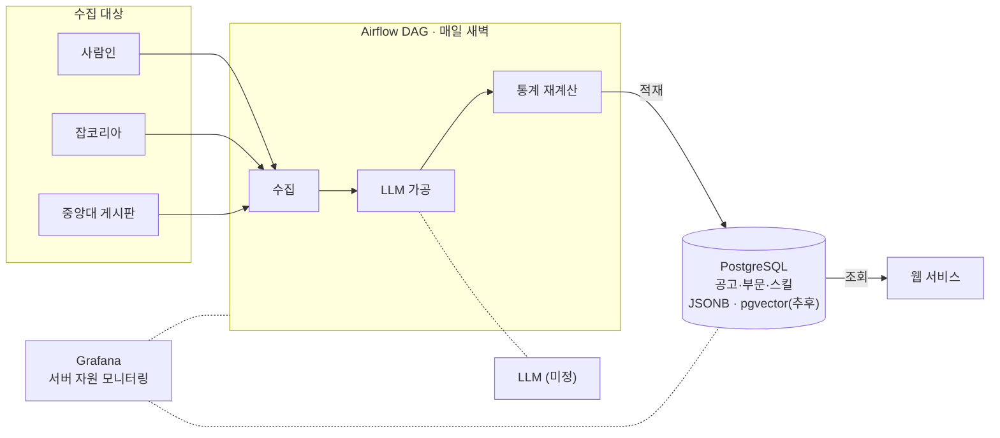
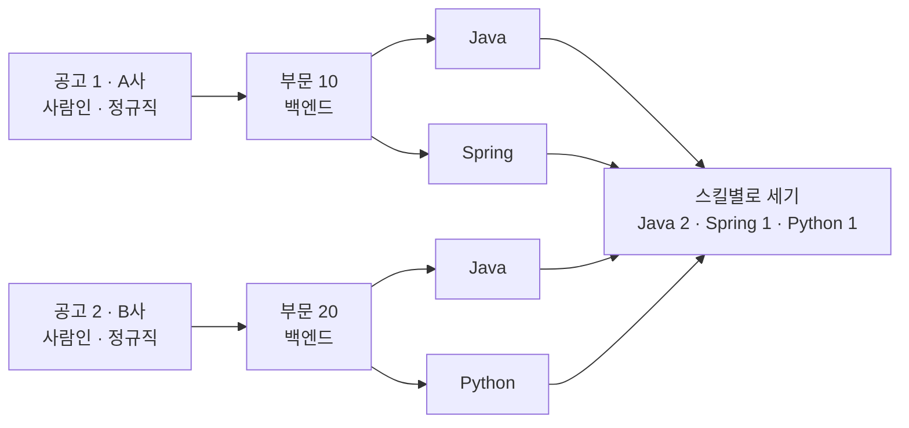
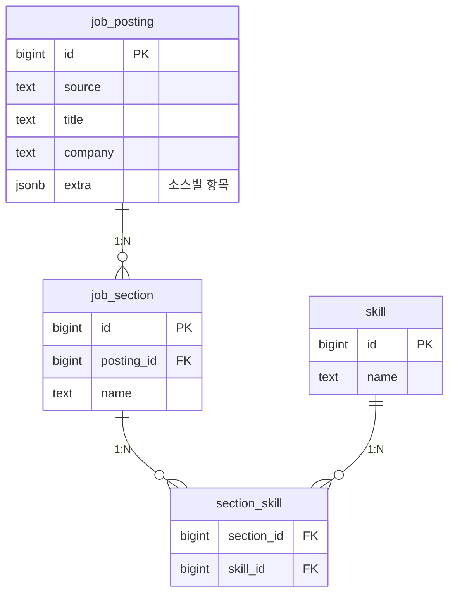
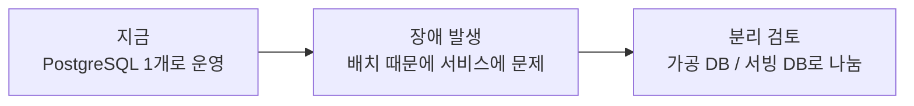

# 파이프라인 기술 스택 결정

> 공고 수집 → LLM 가공 → 통계 계산을 맡는 파트의 기술 스택입니다. (2026-10-01)

## 결정 요약

- **DB** : PostgreSQL
- **파이프라인 오케스트레이션** : Airflow
- **모니터링** : Grafana
- **LLM** : 미정

## 전체 구조



DB는 1개입니다. 파이프라인과 웹이 같은 PostgreSQL을 쓰고, 파이프라인은 새벽에 돕니다.

---

## Airflow · Grafana를 쓰는 이유

| 도구 | 맡는 일 | 고른 이유 |
| --- | --- | --- |
| **Airflow** | 수집 → LLM 가공 → 통계 재계산을 순서대로 매일 실행 | 실패 시 자동 재시도 · 백필(지난 날짜 다시 돌리기) · 스케줄 관리 |
| **Grafana** | 서버 자원 상태 확인 | 서버 자원 상태를 한눈에 시각화 |

---

## MongoDB 대신 PostgreSQL을 고른 이유

> MongoDB의 장점(유연한 구조)은 JSONB로 가져오고, 서비스 핵심인 스킬 통계는 RDB로 해결합니다.

| 필요한 것 | MongoDB | PostgreSQL |
| --- | --- | --- |
| 사이트·공고마다 다른 항목 | ✅ 정해진 틀 없는 문서 | ✅ JSONB 칼럼에 저장 |
| LLM의 JSON 응답 저장 | ✅ JSON 문서 그대로 저장 | ✅ JSONB에 그대로 저장 |
| 소스 추가 시 구조 변경 | ✅ 변경 없음 | ✅ 공통 칼럼은 그대로, 다른 항목은 JSONB |
| ⭐ **조건별 공고의 스킬 개수 통계 (핵심)** | ⚠️ 집계 파이프라인으로 가능하지만 복잡 | ✅ JOIN + GROUP BY, RDB 기본 기능 |
| 공고 → 부문 → 스킬 정합성 | ❌ 외래키 없음, 앱 코드가 책임 | ✅ 외래키로 DB가 보장 |
| 벡터(임베딩) 검색 확장 | – 검토 범위 밖 | ✅ 무료 확장 pgvector, 같은 DB에서 처리 |
| **합계** | ✅ 3 · ⚠️ 1 · ❌ 1 | ✅ 6 |

✅ 잘 맞음 · ⚠️ 가능하지만 불편 · ❌ 지원 안 함 · – 비교 안 함

> 참고: MySQL도 후보였지만 커뮤니티판은 벡터 거리 계산 함수를 제공하지 않아 제외했습니다.

### 핵심 통계는 어떻게 나오나 (예시로 따라가기)

우리 서비스가 답해야 하는 질문의 예:

> **"사람인 정규직 공고에서, 백엔드 부문에 가장 많이 나온 스킬은?"**

#### 데이터는 표 3개에 나눠 담깁니다

공고 하나에 부문이 여러 개 있을 수 있고(백엔드·프론트엔드), 부문마다 요구 스킬이 여러 개라서 표를 나눕니다. 각 표는 **번호(id)로 서로를 가리킵니다.**

**① 공고**

| 공고 id | 사이트 | 회사 | 사이트마다 다른 항목 (JSONB) |
| --- | --- | --- | --- |
| 1 | 사람인 | A사 | `{"employment_type": "정규직"}` |
| 2 | 사람인 | B사 | `{"employment_type": "정규직"}` |
| 3 | 잡코리아 | C사 | `{"deadline": "상시"}` |

**② 부문** — "몇 번 공고의 부문인지"를 적어 둠

| 부문 id | 공고 id | 부문 |
| --- | --- | --- |
| 10 | 1 | 백엔드 |
| 11 | 1 | 프론트엔드 |
| 20 | 2 | 백엔드 |
| 30 | 3 | 데이터 |

**③ 부문별 스킬** — "몇 번 부문의 스킬인지"를 적어 둠

| 부문 id | 스킬 |
| --- | --- |
| 10 | Java |
| 10 | Spring |
| 11 | React |
| 20 | Java |
| 20 | Python |
| 30 | Python |

#### 번호를 따라가면서 고르고, 마지막에 셉니다



| 단계 | 하는 일 | 결과 |
| --- | --- | --- |
| 1. 공고 고르기 | 사이트 = 사람인, 고용형태 = 정규직 | 공고 1, 2 (공고 3은 잡코리아라 제외) |
| 2. 부문 따라가기 | 고른 공고의 부문 중 백엔드만 | 부문 10, 20 (부문 11은 프론트엔드라 제외) |
| 3. 스킬 따라가기 | 고른 부문의 스킬을 모두 모음 | Java, Spring, Java, Python |
| 4. 세기 | 같은 스킬끼리 묶어서 개수 세기 | 아래 결과 |

**결과**

| 스킬 | 공고 수 | |
| --- | --- | --- |
| Java | 2 | ■■ |
| Spring | 1 | ■ |
| Python | 1 | ■ |

#### 그래서 왜 PostgreSQL인가

| | 하는 일 | PostgreSQL에서는 |
| --- | --- | --- |
| 2~3단계 | 번호로 다른 표를 따라가 이어 붙이기 | `JOIN`, RDB 기본 기능 |
| 4단계 | 같은 것끼리 묶어서 세기 | `GROUP BY` + `COUNT`, RDB 기본 기능 |
| 데이터 저장할 때 | 부문이 존재하지 않는 공고 번호를 가리키지 못하게 막기 | 외래키(FK)가 자동으로 막아 줌 |

이 4단계가 **SQL 쿼리 한 번**으로 끝납니다. 아래는 개발용 참고 자료입니다.

```sql
SELECT s.name, COUNT(*) AS cnt                       -- 4. 스킬별로 세기
FROM job_posting p
JOIN job_section   js ON js.posting_id = p.id        -- 2. 공고 → 부문 따라가기
JOIN section_skill ss ON ss.section_id = js.id       -- 3. 부문 → 스킬 따라가기
JOIN skill         s  ON s.id = ss.skill_id
WHERE p.source = 'saramin'                           -- 1. 공고 고르기
  AND p.extra->>'employment_type' = '정규직'          --    (JSONB 항목도 조건에 바로 사용)
  AND js.name = '백엔드'                              -- 2. 백엔드 부문만
GROUP BY s.name                                      -- 4. 같은 스킬끼리 묶기
ORDER BY cnt DESC;
```

실제 테이블 구조 (확정 전 예시). 스킬 이름은 `skill` 표에 한 번만 저장하고, 연결 표에는 번호만 둡니다.



---

## 가공 DB와 서빙 DB를 나눌까?

> 매일 도는 배치(수집·LLM 가공·통계 재계산)가 웹 조회를 느리게 할 수 있어서 분리를 검토했습니다.

| 기준 | 분리 (DB 2개) | DB 1개 |
| --- | --- | --- |
| 배치 중 웹 조회 속도 | ✅ 영향 없음 | ⚠️ 느려질 수 있음 (배치는 새벽) |
| 장애 격리 | ✅ 디스크가 차거나 배치가 폭주해도 서비스 유지 (서버를 따로 쓸 때만) | ❌ 함께 영향받음 |
| 보안 | ✅ 크롤러 쪽이 뚫려도 서비스 데이터에 닿지 않음 | ⚠️ 계정 권한으로 보완 |
| 팀 분업 | ✅ 웹과 파이프라인이 서로 영향 없이 관리 | ⚠️ 같은 DB를 함께 관리 |
| 통계 갱신 | ⚠️ DB 사이에 데이터를 옮겨야 함 | ✅ SQL 한 번, 트랜잭션 1개로 끝 |
| 데이터 일관성 | ❌ 두 DB가 서로 어긋날 위험 | ✅ 어긋날 일 없음 |
| 설치·백업·모니터링 | ❌ 각각 따로 | ✅ 하나로 끝 |

### ✅ 결정: DB 1개로 시작하고, 나누기 쉽게 만들어 둔다

- 웹 조회가 조금 느려져도 우리 서비스에는 치명적이지 않다.
- 파이프라인은 새벽에 돌아서 영향받는 사용자가 적다.



### 나누기 쉽게 만드는 방법 (제안 · 의견 주세요)

| 방법 | 내용 |
| --- | --- |
| 스키마 분리 | 가공용(`raw`)과 서비스용(`serving`) 스키마를 처음부터 나눔 |
| 계정 분리 | 웹은 `serving`만 읽는 전용 계정으로 접속 |
| 접속 정보 분리 | 웹과 파이프라인의 DB 주소를 각각 환경변수로 두어, 나눌 때 주소만 변경 |

---

LLM 선택은 정해지면 추가합니다. 질문이나 반대 의견은 편하게 주세요.
