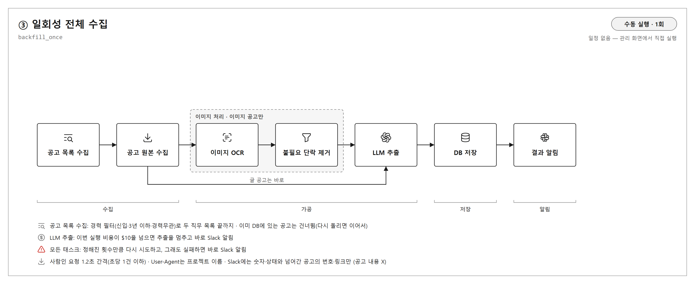
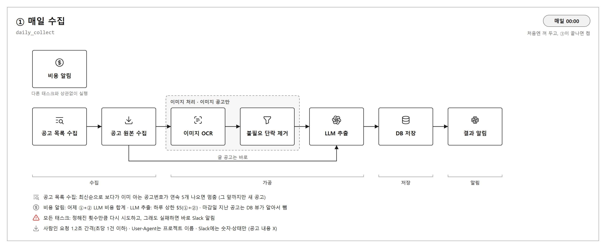
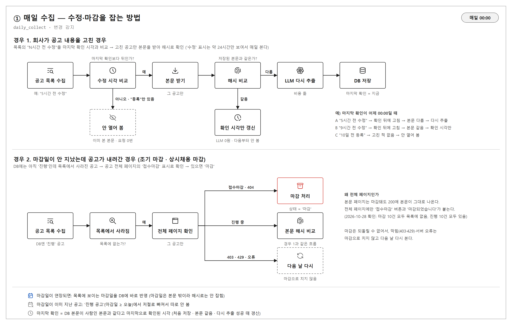

# Airflow DAG 설계 — 채용공고 역량 추출 파이프라인 자동화

작성: 2026-10-27 · 대상 폴더: `job-skill/` · 브랜치: `feature/job-skill`

## 1. 왜 만드나

지금 파이프라인(수집 → OCR → 단락 거르기 → LLM 추출 → 표준화 → 모집 단위 검사 → DB 저장)은 스크립트를 사람이 하나씩 손으로 돌린다.
이걸 **Airflow가 정해진 시간에 알아서 돌리게** 해서, 사람인의 백엔드·데이터 엔지니어 공고가 매일 DB에 쌓이게 한다.
DB는 웹 서비스(BE)가 같이 읽는다. 그래서 DB에 들어간 공고와 역량이 늘 최신이어야 한다.
- 웹이 보여 줄 통계는 웹이 필요할 때 DB에서 바로 센다.
- 공고 수가 많지 않아서 미리 세어 두는 단계는 두지 않는다.

## 2. 목표

DAG를 2개 만든다. 시간은 모두 **한국 시간(KST)** 기준이다.
(처음에는 ② 수정 확인까지 3개였지만, 2026-10-28 사용자 결정으로 ②를 ①에 합쳤다 — 아래 "① 매일 수집" 참고)

| DAG | 언제 | 하는 일 |
|---|---|---|
| ③ 일회성 전체 수집 | 사용자가 관리 화면에서 **직접 한 번** 실행(일정 없음) | 지금 진행 중인 대상 공고 전부(약 1,500건)를 수집해 DB 저장까지 끝낸다. |
| ① 매일 수집 | **매일 00:00** | 목록 전체를 보고 새 공고를 수집하고, **고쳐진 공고**는 바뀐 것만 다시 추출하고, **내려간 공고**는 마감 처리해 DB 저장까지 끝낸다. |

**대상 공고**
- 사람인 직무 분류 **백엔드/서버개발(`cat_kewd=84`)**과 **데이터엔지니어(`83`)** 두 직무만
- 목록의 경력 조건으로 계산한 **최소 요구 연수가 3년 이하**인 공고만(신입·경력무관 = 0년)
  - 목록은 사람인 경력 필터(신입·경력 3년 이하·경력무관)를 켜고 받는다(2026-10-28 사용자 결정 — 사람인 필터를 믿음).
- **4년 이상은 아예 받지 않는다.** 본문도 요청하지 않고 원본도 저장하지 않는다.
- 고용형태 '교육생' 공고는 받지 않는다.

**공고 하나를 처리하는 순서** (①·③ 모두 같다. 지금 있는 코드를 그대로 쓴다)
1. 본문(`relay/view-detail`)과 본문 이미지 받기 — `fetch_images.py`
2. 글 공고는 보이는 글만 쓰기 — `html_text.py`
3. 이미지 공고:
   - PaddleOCR로 글자와 좌표 뽑기 — `dump_paddle_boxes.py`
   - 단락을 나누고 필요 없는 단락 빼기 — `section_split.py --paddle-only`
   - 표 정리 — `table_layout.py`
4. LLM 추출 + 표준화 + 모집 단위 검사(의심되면 한 번 다시 부르기) — `extract_skills.py`
   - 설정: `gpt-5.6-luna`, reasoning `low`, 예시 답안 포함(`--examples`)
5. DB 저장 — `db_load.py`
   - 공고는 (사이트, 공고번호)로 겹치지 않게 넣고, 추출 결과는 새 '추출 실행'으로 넣는다(현재 사용 = 새 결과).

## 3. 정한 것

### 순서와 겹침
운영 순서로 겹침을 막는다(사용자 결정). 그래서 "실행 조건 확인"이나 "완료 기록" 태스크는 두지 않는다.
1. ①은 **처음에 꺼진 상태(일시정지)**로 올라온다. ③은 일정이 없어 켜진 채로 올라온다(저절로 돌지 않음).
2. 사용자가 관리 화면에서 **③을 직접 한 번 실행**한다.
3. ③이 끝나면 사용자가 **①을 켠다.** 켜는 순간 놓친 가장 최근 회차가 **한 번 바로** 돌고(Airflow `catchup=False` 기본 동작), 그다음부터 매일 00:00에 돈다.

- ③은 이미 DB에 있는 공고를 건너뛴다. 중간에 멈추거나 실패해도 다시 실행하면 이어서 하고, 실수로 한 번 더 눌러도 목록만 훑고 끝난다.
- **그래도 겹칠 때(최종 검토 고침):** ③이 끝나기 전에 ①을 켜면 둘이 같이 돌 수 있다. 그래서 자리 1개짜리 Airflow 풀 3개를 둔다(태스크를 더하지 않는 설정).
  - `saramin`: 사람인 요청 태스크(공고 목록 수집·변경 감지·공고 원본 수집) — 초당 1건 유지
  - `gpu`: 이미지 OCR — GPU 6GB 하나
  - `llm`: LLM 추출 — 앞 실행이 쓴 돈을 보고 하루 상한을 계산

### ① 매일 수집 (2026-10-28: 예전 ② 수정 확인을 합침, 사용자 결정)
**왜 합쳤나:** 2026-10-28 실제 목록 2,309건을 보니 '수정' 표시는 "N시간 전 수정"·"N분 전 수정"으로만 나오고(116건), "N일 전 수정"은 0건이었다. 하루가 지나면 원래 등록일("N일 전 등록", 공고번호 순서와 거의 같음)로 돌아가 고친 것을 알 수 없다. (사용자가 사람인에서 직접 확인: 24시간이 넘으면 "수정"이 "등록"으로 바뀜) 그래서 3일마다 보는 ②로는 수정을 대부분 놓친다. 매일 목록 전체를 보는 ①이 같은 목록으로 수정·마감까지 확인한다.

- **공고 목록 수집 — 목록 전체, 경력 필터 (사용자 결정)**
  - 두 직무 목록을 사람인 경력 필터(`exp_cd=1,2&exp_max=3&exp_none=y`)를 켜고 **끝까지** 본다(필터 없이 백엔드 19쪽·데이터 엔지니어 9쪽, 2,309건이었음).
  - **새 공고 = 목록 − 아는 번호**(DB 공고 + 버린 공고). 아는 번호는 건너뛸 뿐 멈추지 않는다("연속 5개 멈춤"은 없앰 — 목록을 어차피 끝까지 봄).
  - 멱등성: 두 번 돌리면 두 번째에는 고른 공고·버린 공고가 모두 아는 번호라 새 공고 0건이다. 공고는 (사이트, 공고번호)로 한 줄만, 추출 실행은 입력 해시로 한 번만 들어간다.
  - 교육생(경력 필터로 안 걸러짐)·경력 조건 모름은 버리고 번호를 기억한다(`listing_seen`, 본문 요청 없음). 버린 공고 기록은 **DB 저장 단계에서 공고를 저장한 뒤** 한다.
  - 두 직무 목록에 같이 나오는 공고는 먼저 본 직무 하나로만 넣는다.
  - 빈 쪽, 또는 그 직무에서 이미 본 공고만 있는 쪽(끝을 넘겨 마지막 쪽을 되풀이)에서 그 직무는 끝. 목록 1쪽이 200인데 공고가 0개면(화면이 바뀌었거나 막힘) 태스크를 실패시킨다.
  - **밀린 공고 먼저 (사용자 결정):** 진행 공고 가운데 추출 결과가 하나도 없는 공고를 targets 맨 위에 둔다.
- **같은 목록으로 수정·마감 확인 (예전 ②)** — 변경 감지 태스크
  - **수정:** 목록의 "N시간 전 수정"을 시각으로 바꿔 DB의 **마지막 확인 시각**(`posting.last_checked_at`)보다 뒤인 진행 공고만 본문을 받아 지문을 비교한다.
    - 표시가 내림인지 반올림인지 몰라 한 단위 여유를 둬 늦게 잡는다(지금 − (N−1)).
    - 지문은 **보이는 글(띄어쓰기·줄바꿈 제거) + 이미지 주소**(`db_load.content_hash`). 사람인 본문 HTML에는 요청마다 색 값이 무작위인 빈 `<font>` 태그가 있어 HTML 그대로는 비교할 수 없다.
    - 다르면 원본을 새로 저장하고 다시 추출한다(예전 추출 실행은 기록으로 남음). 같으면 마지막 확인 시각만 지금으로 바꾼다.
  - **마감:** DB에는 진행인데 목록에서 사라진 공고는 **공고 전체 페이지(`jobs/view`)의 마감 표시**로 확인한다.
    - 본문 페이지(`relay/view-detail`)는 마감돼도 200에 본문이 그대로라 마감을 알 수 없다. 전체 페이지에만 "접수마감" 버튼(`sri_btn_expired_apply`)과 "마감되었습니다"가 붙는다.
    - 2026-10-28 실제 확인: DB 샘플 20건 중 마감 10건은 모두 목록에 없었고, 진행 10건은 모두 목록에 있었다.
    - 마감 표시·404·410 → '마감'. 마감 표시가 없으면 진행 중(목록에서만 빠짐) → 본문 지문 비교. 403·429·5xx·연결 실패 → 막힘·일시 장애일 수 있어 마감으로 치지 않고 다음 날 다시 본다(마감은 되돌릴 수 없음).
  - **마감일:** 목록에 보이는 진행 공고의 마감일을 목록 값으로 DB에 반영한다(마감일은 본문 밖이라 지문으로는 안 잡힘, DB 마감일이 이미 지났어도 목록에 있으면 연장으로 봄).
  - 하루 요청 수: 목록 + 새 공고 + 고쳐진 공고(하루 수십) + 사라진 공고(하루 수십).
- **마감일 지난 공고 (마감 처리 태스크 없음, 사용자 결정)**
  - 파이프라인은 마감일과 상태를 **저장**만 한다. 웹에서 진행 공고만 보여 주는 뷰·조회는 BE 몫이라 만들지 않는다.
  - 파이프라인 안에서 "진행 공고"가 필요할 때는 코드 안 조회로 고른다: `status = '진행' AND (deadline IS NULL OR deadline >= 오늘)`. 마감일이 지난 공고는 여기서 저절로 빠진다.
  - 마감 공고는 지우지 않는다.
- **원본 갱신 규칙:** 이미 있는 공고의 원본(위치·해시)과 마지막 확인 시각은 **다시 추출에 성공했을 때만** 바꾼다. 실패하면 둘 다 옛 값이 남는다.
  - 알려진 한계: '수정' 표시가 약 24시간만 보여서, 고쳐진 공고의 다시 추출이 실패(비용 상한 등)하면 다음 날에는 표시가 사라져 다시 잡히지 않을 수 있다.

### 비용 상한
- **하루 상한 $5.**
  - 그날(KST 00:00~24:00) ①이 쓴 LLM 비용으로 본다(예전에는 ①+② 합산).
  - 기준은 DB의 `extraction_run.cost_usd`이고, 다시 부른 비용도 포함한다.
    - → 바꿈(최종 검토 고침): DB가 아니라 ① 실행 폴더의 추출 결과 파일(`run_at`, KST 날짜)로 센다. DB에는 ③ 비용도 섞여 ③을 끝낸 날 ①이 아무것도 못 하고, 아직 저장 전인 결과(재시도·실패한 실행·같이 도는 실행)는 DB에 없어 상한을 넘을 수 있었다.
  - 공고 하나의 LLM 오류(응답 잘림·거절)는 그 공고만 건너뛰고 계속한다. 그 공고는 결과 없이 저장돼 다음 ①의 밀린 공고가 된다. 전부 실패하면 태스크를 실패시킨다.
- **③의 상한은 $10.** ③ 한 번 실행에 쓴 비용으로 본다.
- 상한을 넘으면 그 DAG의 LLM 추출을 멈추고 **바로 Slack으로 알린다.**
  - 수집과 원본 저장은 계속해도 된다.
  - 추출 안 된 공고는 다음 실행 때 처리된다.

평소 예상 비용: 평일 약 $0.4, 주말 약 $0.1, ③은 한 번 약 $6. 공고당 약 $0.004다.

### Slack 알림
보내는 곳은 Slack 채널 웹훅이다. 웹훅 주소는 사용자가 직접 만들어 `job-skill/.env`의 `SLACK_WEBHOOK_URL`에 넣는다.
- **실패:** 어떤 단계든 정해진 재시도 뒤에도 실패하면 바로 알린다(어느 DAG의 어느 단계인지, 오류 요약).
- **상한 초과:** 비용 상한을 넘어 추출을 멈추면 바로 알린다.
- **실행 요약:** ①·③이 끝날 때마다 숫자로 요약한다. 예: ① "새 공고 52 · 밀린 공고 0 · 수정 30 · 바뀜 14 · 목록에 없음 12 · 마감 9 · 마감일 바뀜 5 · 오류 0 · 추출 66 · 확인 필요 2 · 비용 $0.27 · 오늘 비용 $0.27"
- **하루 비용:** 매일 그날 쓴 LLM 비용 합계를 보낸다.
  - **제 판단:** ①이 00:00에 시작할 때 **어제 하루** 합계를 먼저 보낸다.

### 환경
- **전부 로컬(이 노트북).** 노트북은 늘 켜져 있다고 가정한다.
- **Airflow:** Docker로 띄우고, 관리 화면은 `http://localhost:8080`이다. 실행 기록, 단계별 성공·실패, 로그, 수동 실행을 여기서 본다.
- **OCR은 GPU로만 돌린다(사용자 결정).** Docker 안에서 GPU를 쓸 수 없으면 CPU로 바꾸지 말고 **멈추고 사용자에게 알린다.**
- **DB:** 이미 있는 Docker PostgreSQL을 쓴다.
  - `docker-compose.yml`의 `career-db`, `localhost:5433`, DB·계정 `career`
  - 표는 모두 `job` 스키마에 있다(`db/schema.sql`, 설명은 `docs/physical-design.md`).
- **원본 파일:** 이 노트북의 폴더에 쌓는다. DB에는 파일 위치와 해시만 넣는다.
- **비밀 정보:** DB 비밀번호, `OPENAI_API_KEY`, Slack 웹훅 주소는 `job-skill/.env`에 둔다. 이 파일은 저장소에 올리지 않는다.
  - **제 판단:** `OPENAI_API_KEY`는 지금처럼 노트북 환경변수에서 컨테이너로 넘겨도 된다.
- **제 판단:** Airflow 컨테이너에서 DB에 접속할 때는 `localhost`가 아니라 Docker 네트워크나 `host.docker.internal:5433`을 쓴다.

## 3-0. 컨테이너 구성 (사용자 결정)

Docker 묶음을 둘로 나눈다. `docker-compose.yml`도 묶음마다 하나씩 둔다.

```
[ Airflow 묶음 ]  ─ 매일 작업 실행 ─────▶  [ 서빙 DB 묶음 ]  ◀─ 웹 서비스(BE)가 읽기
```

**서빙 DB 묶음:** 지금 있는 `career-db` 그대로 둔다(`localhost:5433`). `job` 스키마에 파이프라인 결과가, `public` 스키마에 BE 표가 들어간다.

**Airflow 묶음**
- 계속 켜지는 컨테이너 4개
  - 관리 화면(api-server, `localhost:8080`)
  - 일정 관리(scheduler, 로컬 구성이라 OCR·LLM 같은 태스크도 여기서 돈다)
  - DAG 읽기(dag-processor)
  - **Airflow 전용 DB**: 실행 기록·태스크 상태를 담는다. 서빙 DB에는 넣지 않는다.
- 처음 한 번만 도는 컨테이너: 초기 설정(airflow-init). Airflow DB 표와 관리 화면 계정을 만든다.
- 그 밖에 필요한 것
  - **우리 작업용 Airflow 이미지:** 기본 Airflow + PaddleOCR(GPU)·openai·psycopg 등
  - **GPU 연결:** 일정 관리 컨테이너가 노트북 GPU를 쓰게 한다.
  - **연결 폴더:** 코드·DAG, 원본 공고 파일, 로그, OCR 모델 캐시
  - **`.env`:** OpenAI 키, Slack 웹훅, 서빙 DB 접속 정보

**넣지 않는 것:** triggerer, Celery 작업자·Redis·Flower, OCR 전용 컨테이너, airflow-cli, 측정 도구(StatsD·Prometheus·Grafana), DB 관리 화면

**메모리:** Docker가 쓸 수 있는 메모리는 최대 8GB(`.wslconfig`)다. 평소 약 1.8GB, OCR이 돌 때 최대 약 4.7GB로 예상한다.

## 3-1. 태스크 구성 (그림)

Airflow 그래프의 관례대로 그렸다.
- 상자 = 태스크, 화살표 = 순서
- 갈라진 갈래는 서로 기다리지 않고 동시에 돌 수 있다(예: ①에서 변경 감지 뒤의 마감 처리와 공고 원본 수집).
- 점선 묶음(이미지 처리)은 이미지 공고만 거친다. 글 공고는 공고 원본 수집에서 바로 LLM 추출로 간다.
- ①의 비용 알림은 다른 태스크와 상관없이 돈다.
- 모든 태스크는 정해진 횟수만큼 다시 시도하고, 그래도 실패하면 바로 Slack으로 알린다.

**③ 일회성 전체 수집 `backfill_once`** — 수동 실행, 1회


**① 매일 수집 `daily_collect`** — 매일 00:00


**① 안의 수정·마감 확인이 두 경우를 잡는 방법**


## 4. 하지 않는 것

- Grafana 모니터링: 로컬이라 Airflow 화면으로 충분하다.
- 통계 미리 계산(통계 재계산 단계)
- 공용 서버·클라우드 배포: 나중에 팀이 정한다.
- 다른 사이트(잡코리아 등)와 다른 직무
- 사용자 역량 추출·매칭
- 관리자(확인 필요 공고 검토) 화면
- Batch API(반값 비동기 처리)

## 5. 이렇게 되면 실패다

- 사람인에 초당 1건이 넘게 요청하거나, User-Agent를 브라우저로 꾸미는 것.
  - 지금 규칙: 요청 사이 1.2초 이상, UA는 프로젝트 이름(`fetch_images.UA`).
- **공고 내용이 이 노트북 밖으로 나가는 것.**
  - 받은 이미지, 본문, OCR 글자, 추출 결과는 GitHub에 올리지 않는다(`.gitignore`).
  - **Slack 메시지에는 숫자·상태·오류만 넣고, 공고 제목이나 내용은 넣지 않는다.**
- 버그로 LLM 비용이 상한을 넘어 계속 나가는 것
- 같은 공고나 같은 추출 결과가 DB에 두 번 들어가는 것
- ③이 도는 도중에 ①이 끼어들어 같은 공고를 동시에 처리하는 것

## 6. 지켜야 할 것

- 기존 스크립트의 동작(지시문, 표준화, 검사 규칙)은 바꾸지 않는다. Airflow는 그것들을 **순서대로 부르는** 역할이다.
  - 경로·입출력 방식처럼 Airflow에 맞추려고 고쳐야 하는 부분은 고쳐도 된다.
- Python 3.12. 의존성은 `requirements-paddle.txt`, `pillow`, `numpy`, `openai`, `psycopg[binary]`이다.
- PaddleOCR 버전은 `paddleocr 3.7.0` + `paddlepaddle(-gpu) 3.2.2`다. 3.3.1은 이 PC에서 오류가 나서 쓰지 않는다.
- OCR은 지금 노트북 GPU(RTX 3060 Laptop 6GB, 드라이버 616.92, CUDA 12.6 휠)에서 이미지당 약 2.3초다.
- 노트북 메모리는 약 14GB다. Airflow, DB, OCR이 같이 돌아야 하니 Airflow는 가벼운 구성으로 한다.
- 지금 DB에는 sample3 공고 20건이 들어 있다. ③은 이 공고들을 '이미 있음'으로 보고 건너뛴다.

## 7. 만드는 사람에게 맡기는 것

- **Airflow:** 버전은 3.3.2(사용자 결정), 실행기는 로컬이니 가벼운 구성(LocalExecutor). 컨테이너 구성은 3-0에서 정했다.
- **GPU를 Docker 안에서 쓰게 하는 방법:** WSL2 + NVIDIA 컨테이너 런타임 등
- **원본 폴더 구조:** 실행(날짜)별 데이터 폴더를 만들어 기존 스크립트를 `OCR_DATA_DIR`로 돌리는 방식을 권장한다. 그 폴더를 `.gitignore`에 넣는다.
- **기존 스크립트를 부르는 방법:** 함수 import 또는 subprocess
- **기타:** 단계 나누기(태스크 단위), 재시도 횟수와 간격, Slack 메시지 모양
- **"3일에 한 번" 일정을 만드는 방법:** → 필요 없어짐. ② 수정 확인을 ① 매일 수집에 합쳤다(2026-10-28 사용자 결정).
- **시험 방법:** 사람인 요청을 몇 건만 하는 작은 실행, 가짜 LLM, 시험용 DB 등
